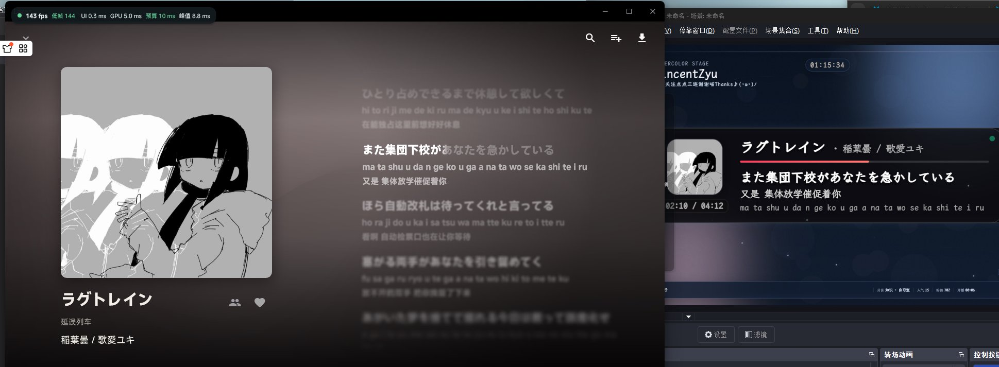

# WebSocket 外部服务端桥接 (`lazer-plugin-ws-server-bridge`)

专为 [**Lazer**](https://github.com/chuxuehaocai/Lazer) 打造的外部 WebSocket 状态广播与双向控制插件，原生兼容 [**SPlayer-Next**](https://github.com/SPlayer-Dev/SPlayer-Next) 的外部 API 规范。

---

> ### 💡 核心特性与 OBS 零侵入对接说明
> * **OBS 端无需安装任何额外插件**：OBS 维持原有使用习惯，使用原生“浏览器源 (Browser Source)”直接打开 HTML 挂件（例如 [`splayer-status-html-overlay-for-obs`](https://github.com/VincentZyuLive/splayer-status-html-overlay-for-obs) 的 `index.html`）即可。
> * **全面兼容 SPlayer-Next 外部 API 规范**：本插件在 Lazer 本地建立 `ws://127.0.0.1:14558/ws` 广播端点，实时向 OBS 挂件推送当前歌曲、歌手、专辑、封面直链、毫秒进度条及逐行滚动歌词，并支持反向切歌与音量控制。

---

## 📸 运行效果 (Preview)

配合 OBS 原生浏览器源挂载 [`splayer-status-html-overlay-for-obs`](https://github.com/VincentZyuLive/splayer-status-html-overlay-for-obs) 挂件，实机联动效果如下（支持毫秒级 Seek 纠偏、中文翻译与罗马音音译渲染）：

---

## 🎯 功能特性

- **SPlayer-Next 外部 API 协议兼容**：
  - 默认监听本地端口：`14558`
  - WebSocket 广播端点：`ws://127.0.0.1:14558/ws`
- **实时事件广播**：
  - **曲目变更**：`kind: "event", type: "track"`（歌曲名、歌手列表、封面图、总时长等）
  - **滚动歌词**：`kind: "event", type: "lyric"`（主歌词、翻译歌词、罗马音歌词）
  - **播放状态**：`kind: "event", type: "status"`（播放中/暂停、播放进度毫秒、音量等）
- **双向控制支持**：
  - 支持外部工具通过 `control` 指令对 Lazer 进行播放、暂停、切歌、跳转进度和调整音量。
- **与 OBS 挂件完美适配**：
  - 开箱即用支持 [`splayer-status-html-overlay-for-obs`](https://github.com/VincentZyuLive/splayer-status-html-overlay-for-obs)。

---

## 📑 协议规范与官方实现源头

本插件的数据封包格式与交互指令严格对标 [SPlayer-Dev/SPlayer-Next](https://github.com/SPlayer-Dev/SPlayer-Next) 官方实现源头：

* **双向通道与上行控制指令定义**：[`electron/main/server/ws.ts#L1-L11`](https://github.com/SPlayer-Dev/SPlayer-Next/blob/9d3ca78f107b7cbe28b1ef7ce9041de9bad55531/electron/main/server/ws.ts#L1-L11)
* **下行事件广播封包格式**：[`electron/main/server/broadcast.ts#L32-L45`](https://github.com/SPlayer-Dev/SPlayer-Next/blob/9d3ca78f107b7cbe28b1ef7ce9041de9bad55531/electron/main/server/broadcast.ts#L32-L45)

---

## 🚀 安装与使用

### 1. 自动安装（推荐）
在 Lazer 客户端内打开 **设置 -> 插件管理 -> 从插件源安装**，搜索 `ws-bridge` 或 `OBS`，点击安装即可。

### 2. 手动安装
1. 从 [Releases](https://github.com/VincentZyuLive/lazer-plugin-ws-server-bridge/releases) 下载最新的 `lazer.ws.bridge.zip`。
2. 打开 Lazer，进入 **插件管理 -> 导入本地插件**，选择下载的 ZIP 压缩包。
3. 允许插件使用 `WebSocket 服务端` 权限（`127.0.0.1:14558`）。
4. 插件启用后，将在本地监听 `ws://127.0.0.1:14558/ws`。

---

## 📺 OBS 挂件对接方法

1. 下载或打开你的 OBS HTML 挂件（如 `splayer-status-html-overlay-for-obs/index.html`）。
2. 在 OBS 中添加一个 **浏览器源 (Browser Source)**，URL 指向挂件的 `index.html` 本地路径或网页。
3. 挂件将自动连接至 `ws://127.0.0.1:14558/ws`。
4. 在 Lazer 中播放任意歌曲，OBS 画面中的挂件将立即同步显示专辑封面、歌曲信息、进度条以及滚动歌词！

---

## 📜 许可证

本项目采用 [MIT License](LICENSE) 开源。
